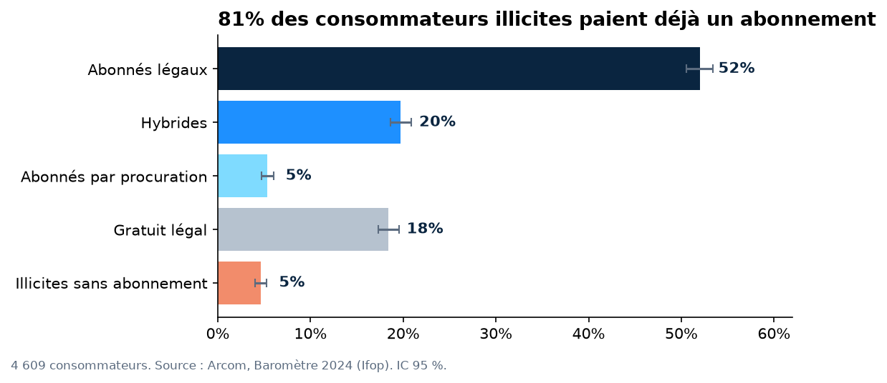
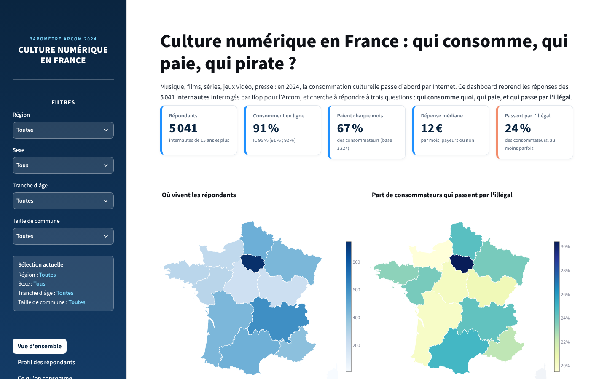
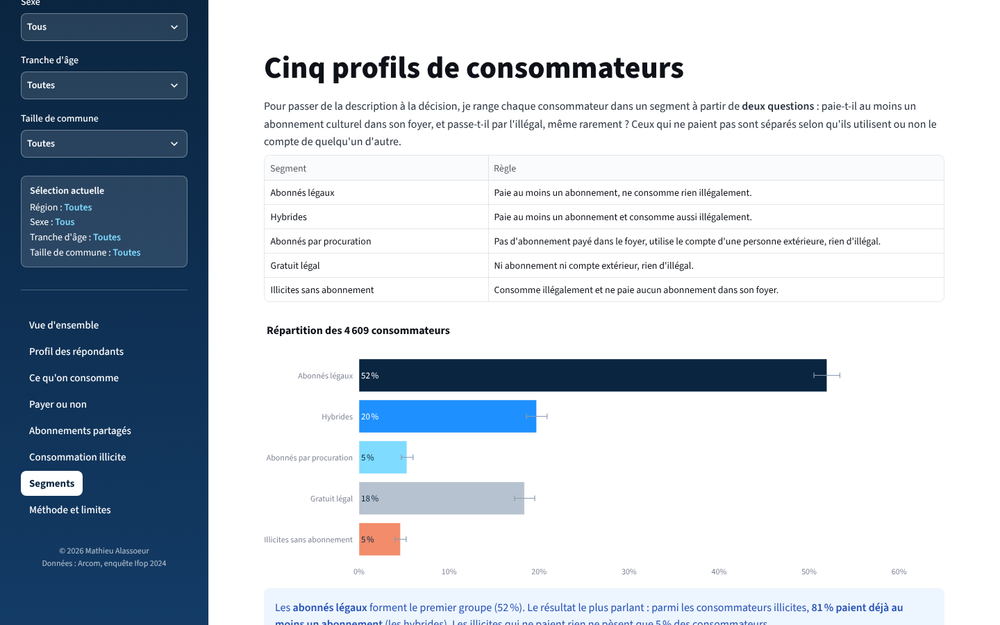
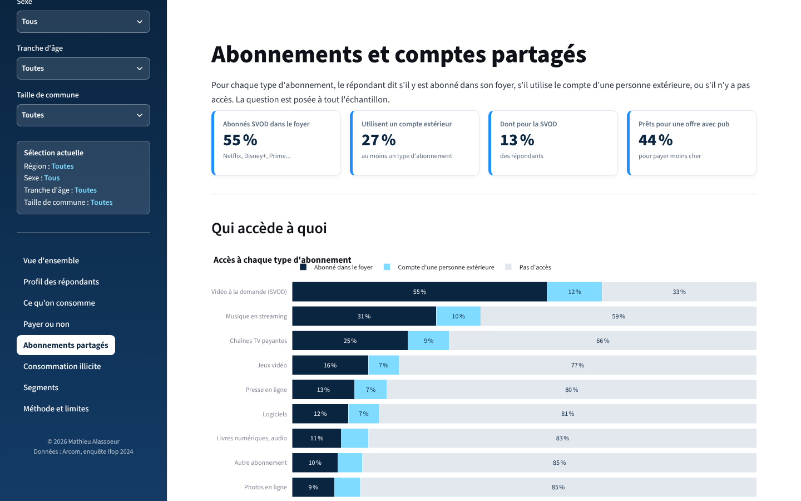

# Culture numérique en France : qui consomme, qui paie, qui pirate ?

[](https://github.com/MatALass/digital-cultural-consumption-analytics/actions/workflows/ci.yml)

Analyse statistique du **Baromètre 2024 de l'Arcom** sur la consommation de contenus culturels en ligne (5 041 internautes interrogés par Ifop), avec une segmentation par règles et un dashboard Streamlit pour l'explorer.

**Le problème.** Les plateformes et les ayants droit veulent savoir qui paie déjà, qui pourrait payer, et qui passe par l'illégal. J'ai repris le fichier individuel de l'enquête pour répondre à ces trois questions, chiffres et intervalles de confiance à l'appui.

**La méthode.** Le pipeline Python décode le fichier brut à partir du dictionnaire des variables. Chaque indicateur est calculé sur la base qui a vraiment reçu la question, avec un intervalle de confiance. Je range ensuite chaque consommateur dans un des 5 segments définis par deux règles, et je teste la sensibilité des segments à ces règles.

**Les résultats.**
- **91 %** des internautes consomment au moins un contenu culturel en ligne. **24 %** des consommateurs passent par l'illégal, au moins de temps en temps.
- L'illicite dépend d'abord de l'âge : **42 %** des 15-24 ans, contre **8 %** des 65 ans et plus (V de Cramér 0,30, contre 0,08 pour la région).
- **81 % des consommateurs illicites paient déjà au moins un abonnement.** Le piratage complète l'offre payante bien plus qu'il ne la remplace. Ce chiffre reste autour de 80 % même avec une définition stricte de l'illicite.
- **1 internaute sur 4** utilise l'abonnement d'une personne extérieure à son foyer, et dans 80 % des cas c'est celui de la famille.
- Le prix est le premier frein au légal : **44 %** des consommateurs illicites citent des abonnements trop chers.



## Le dashboard

Huit pages : vue d'ensemble, profil des répondants, contenus consommés, gratuit ou payant, abonnements partagés, consommation illicite, segments, méthode et limites. Les filtres (région, sexe, âge, taille de commune) s'appliquent à toutes les pages. Tous les textes d'interprétation sont recalculés sur la sélection, aucun chiffre n'est écrit en dur.



| Segments | Abonnements partagés |
|---|---|
|  |  |

## Lancer le projet

Python 3.11 ou plus récent.

```bash
pip install -e ".[dev]"
streamlit run app.py
```

Les tables d'analyse sont déjà dans `data/processed/`, donc l'app démarre directement. Pour les reconstruire depuis le fichier brut de l'Arcom :

```bash
dcca build    # décode le brut, lance les contrôles qualité, écrit data/processed/
dcca check    # vérifie que data/processed/ correspond au brut
```

Tests et lint (lancés aussi par la CI à chaque push, sur Python 3.11 et 3.12) :

```bash
ruff check . && ruff format --check .
pytest
```

## Méthode

### Les données

| Élément | Détail |
|---|---|
| Source | Baromètre 2024 de la consommation des contenus culturels et sportifs dématérialisés, Arcom, terrain Ifop avril-mai 2024 |
| Licence | Licence Ouverte 2.0 (data.gouv.fr), crédit Arcom |
| Échantillon | 5 041 internautes de 15 ans et plus, quotas sexe, âge, profession, région, taille de commune |
| Fichiers | `data/raw/` : fichier individuel (1 518 colonnes) et dictionnaire des variables |

Le questionnaire existe en deux versions (sous-échantillons A et B). Les questions sur le gratuit et le payant, la dépense et les raisons de l'illicite ne sont posées qu'au sous-échantillon B : ces indicateurs sont calculés sur ses 3 233 consommateurs, et la base est affichée partout.

### Le pipeline

`src/dcca/build.py` lit le brut et produit cinq tables, toutes reliées par l'`ID` du répondant (jamais par l'ordre des lignes) :

| Table | Une ligne = |
|---|---|
| `repondants.parquet` | un répondant (profil, indicateurs, score, segment) |
| `contenus.parquet` | un contenu consommé par un répondant (fréquence, licéité, gratuit/payant) |
| `abonnements.parquet` | un type d'abonnement pour un répondant (foyer, compte extérieur, budget) |
| `moyens_illicites.parquet` | un moyen illicite cité pour les films ou les séries |
| `raisons_illicite.parquet` | une raison de ne pas passer par le légal |

`src/dcca/quality.py` fait échouer la construction si un contrôle ne passe pas : unicité des clés, variables posées à tous sans trou, routage cohérent (dépense seulement dans le sous-échantillon B), valeurs plausibles, segmentation exhaustive.

### Le score d'intensité

Note de 0 à 100 : **moitié étendue** (nombre de contenus consommés sur 12), **moitié régularité** (tous les jours = 1, chaque semaine = 2/3, chaque mois = 1/3, moins souvent = 0, en moyenne sur les contenus consommés). Je n'ai pas de variable cible pour estimer les poids, donc je garde le partage le plus simple. Pour le valider, je le confronte à deux variables qu'il n'utilise pas : sa corrélation de Spearman est de 0,37 avec la dépense et de 0,35 avec le nombre d'abonnements, et la dépense médiane monte à chaque quartile du score (0 € pour le premier, 30 € pour le dernier).

### La segmentation

Deux questions, posées à tout l'échantillon, suffisent à placer chaque consommateur :

| Segment | Règle | Part |
|---|---|---|
| Abonnés légaux | paie au moins un abonnement culturel, rien d'illégal | 52 % |
| Hybrides | paie au moins un abonnement et passe aussi par l'illégal | 20 % |
| Gratuit légal | ni abonnement ni compte extérieur, rien d'illégal | 18 % |
| Abonnés par procuration | pas d'abonnement payé, utilise le compte d'une personne extérieure, rien d'illégal | 5 % |
| Illicites sans abonnement | passe par l'illégal et ne paie aucun abonnement | 5 % |

J'ai choisi des règles plutôt qu'un clustering, car chaque segment se lit en une phrase et répond à une question métier. Pour une plateforme, la cible prioritaire est celle des abonnés par procuration : ils consomment déjà l'offre légale, et 49 % accepteraient une offre moins chère avec publicité. Le gratuit légal, lui, est surtout âgé (8 % de moins de 35 ans) et peu intéressé.

**Sensibilité.** Avec une définition stricte de l'illicite (au moins autant d'illégal que de légal), les hybrides passent de 20 % à 9 % : la plupart ne piratent que de temps en temps. La part des illicites qui paient un abonnement, elle, reste stable (81 % contre 80 %). Compter « autre abonnement » comme un abonnement culturel ne change presque rien.

### Statistiques

- Parts : intervalle de Wilson à 95 %. Une part calculée sur moins de 30 personnes est grisée ou masquée.
- Médianes : intervalle bootstrap (2 000 tirages, graine fixe).
- Liens entre variables : test du khi-deux et V de Cramér (segment et tranche d'âge : V = 0,21).

## Limites

- **Pas de pondération.** Le fichier publié n'a pas de variable de poids, alors que l'Arcom redresse ses résultats. Mes chiffres sont donc bruts, et les intervalles supposent un tirage aléatoire simple. Repère : je trouve 91,4 % de consommateurs, l'Arcom publie 91 %. En revanche, j'ai 69 % d'internautes 100 % légaux contre 67 % publiés : l'écart peut venir du redressement ou d'une définition un peu différente, je ne peux pas trancher sans les poids.
- **Déclaratif.** L'illicite est sans doute sous-déclaré.
- **Libellés reconstitués.** Les lignes de la grille d'abonnements (RS12BIS) n'ont pas de libellé dans le dictionnaire. Je les reprends de la question suivante (RS16BIS), et un test vérifie que les filtres du questionnaire ont exactement les mêmes effectifs ligne par ligne.
- **Corrélations, pas causalité.** Les liens avec l'âge ou le segment ne disent pas ce qui fait passer à l'illégal.

## Structure

```text
app.py                       point d'entrée Streamlit
src/dcca/
  config.py                  codes du questionnaire et libellés courts
  codebook.py                lecture du dictionnaire de l'Arcom
  build.py                   brut -> tables d'analyse (clé : ID)
  quality.py                 contrôles qui bloquent la construction
  scores.py, segments.py     score d'intensité et segmentation par règles
  stats.py                   Wilson, bootstrap, khi-deux, V de Cramér
  cli.py                     commandes dcca build / dcca check
  app/                       dashboard (thème, graphiques, une page par fichier)
notebooks/
  01_exploration_et_qualite  structure du fichier, routage, erreurs corrigées
  02_analyse_et_segmentation résultats, validation du score, sensibilité
tests/                       règles, statistiques, décodage sur le vrai fichier, app
data/raw, data/processed, data/geo
```

Les notebooks sont écrits au format `.py` (jupytext) puis exécutés en `.ipynb` : le code reste lisible en revue et les résultats restent visibles sur GitHub.

## Historique

La première version (octobre 2025) était un dashboard de cours à l'EFREI. En reprenant le questionnaire, j'ai trouvé trois erreurs dans mon premier nettoyage : la variable de région était en fait une zone Ifop, la « légalité » ne portait que sur la musique, et un répondant supprimé décalait l'alignement avec le brut. Cette version repart du fichier brut, corrige ces trois points et garde l'identité visuelle du dashboard d'origine. Le détail est dans le notebook 01.

## Licence

Code sous licence MIT. Données : Arcom, Licence Ouverte 2.0. Contours des régions : [france-geojson](https://github.com/gregoiredavid/france-geojson) (Admin Express, Licence Ouverte).
